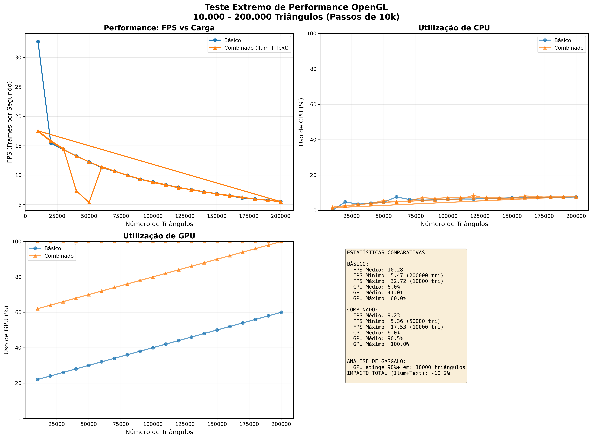

# OpenGL Performance Test

Este projeto implementa um teste completo de desempenho GPU/CPU usando OpenGL, conforme requisitos da disciplina PDI 3.



## Objetivo

Desenvolver um sistema de teste de desempenho que:
- Renderiza triângulos coloridos girando
- Varia a quantidade de triângulos para testar performance
- Monitora uso de CPU e GPU
- Gera relatórios e gráficos de análise
- Testa impacto de iluminação e texturas

## Estrutura do Projeto

```
Teste-de-desempenho-de-GPU-CPU-com-OpenGL/
├── src/                          # Código fonte C++
│   ├── main.cpp                  # Programa básico (triângulo único)
│   ├── demo_interativo.cpp       # 🎮 DEMO INTERATIVA (Principal!)
│   ├── performance_test.cpp      # Teste de performance automatizado
│   ├── advanced_test.cpp         # Teste avançado automatizado
│   ├── Renderer.h/.cpp           # Renderização básica
│   ├── MultiTriangleRenderer.h/.cpp  # Renderização múltiplos triângulos
│   ├── AdvancedRenderer.h/.cpp   # Renderização avançada (efeitos)
│   ├── Lighting.h/.cpp           # Sistema de iluminação
│   ├── Texture.h/.cpp            # Sistema de texturas
│   └── PerformanceMonitor.h/.cpp # Monitoramento de hardware
├── scripts/                      # Scripts Python
│   └── analyze_data.py          # Análise de dados e geração de gráficos
├── data/                         # Dados coletados (CSV)
├── reports/                      # Relatórios e gráficos gerados
├── docs/                         # Relatório final, resumo e guia de apresentação
├── CMakeLists.txt               # Configuração CMake
├── setup.sh                     # Script de instalação de dependências
├── demo.sh                      # 🚀 Script de lançamento da demo
└── README.md                    # Este arquivo
```

## Instalação e Compilação

### 1. Instalar Dependências

```bash
# Executar script de instalação
./setup.sh
```

Ou instalar manualmente:
```bash
sudo apt update
sudo apt install -y build-essential cmake libglfw3-dev libglew-dev libgl1-mesa-dev mesa-utils python3 python3-pip python3-matplotlib python3-pandas
pip3 install matplotlib pandas numpy
```

### 2. Compilar Projeto

```bash
mkdir build
cd build
cmake ..
make -j$(nproc)
```

## Execução

### 🎮 Demo Interativa (RECOMENDADO!)

**A melhor forma de apresentar o projeto:**

```bash
# Opção 1: Script automático
./demo.sh

# Opção 2: Direto
cd build
./DemoInterativo
```

**Controles da Demo Interativa:**
- `1` - Modo BÁSICO (sem efeitos)
- `2` - Modo ILUMINAÇÃO (luz omnidirecional + spotlight)
- `3` - Modo TEXTURAS (texturas procedurais)
- `4` - Modo COMBINADO (iluminação + texturas)
- `↑` ou `+` - Aumentar triângulos (+100)
- `↓` ou `-` - Diminuir triângulos (-100)
- `R` - Resetar para configuração inicial
- `H` - Mostrar/Ocultar ajuda
- `ESC` - Sair

### Outros Programas Disponíveis

**Teste Básico (Triângulo Único):**
```bash
./build/OpenGL_Performance_Test
```

**Teste de Performance Automatizado:**
```bash
./build/PerformanceTest
```

**Teste Avançado Automatizado:**
```bash
./build/AdvancedTest
```

**Controles dos testes automatizados:**
- `ESPAÇO`: Iniciar/Pausar teste
- `R`: Reset do teste
- `L`: Alternar iluminação (somente AdvancedTest)
- `T`: Alternar texturas (somente AdvancedTest)
- `ESC`: Sair

## Análise de Dados

Após executar o teste de performance, os dados são salvos em `data/performance_data.csv`.

Para gerar gráficos e análise:

```bash
python3 scripts/analyze_data.py data/performance_data.csv
```

Os gráficos são salvos na pasta `reports/`:
- `fps_vs_triangles.png`: FPS vs Número de Triângulos
- `cpu_gpu_usage.png`: Uso de CPU e GPU
- `lighting_impact.png`: Impacto da iluminação
- `texture_impact.png`: Impacto das texturas
- `summary_table.txt`: Tabela resumo dos resultados

## Funcionalidades Implementadas

### ✅ Etapa 1: Programa Básico
- [x] Triângulo colorido girando
- [x] Cálculo e exibição de FPS
- [x] Uso de GLFW para janela
- [x] Uso de GLEW para carregar funções OpenGL
- [x] Shaders modernos (OpenGL 3.3+)

### ✅ Etapa 2: Teste de Performance
- [x] Renderização de múltiplos triângulos
- [x] Variação configurável da quantidade
- [x] Registro de FPS médios
- [x] Geração de gráficos FPS × triângulos

### ✅ Etapa 3: Monitoramento de Hardware
- [x] Identificação da GPU
- [x] Verificação de qual GPU está sendo usada
- [x] Monitoramento de % de uso CPU e GPU
- [x] Informações do processador

### ✅ Etapa 4: Efeitos Gráficos
- [x] Luz omnidirecional
- [x] Luz spotlight
- [x] Texturas procedurais nas formas
- [x] Testes de performance com efeitos
- [x] Sistema de shaders com iluminação
- [x] Coordenadas de textura (UV mapping)

### ✅ Etapa 5: Relatório Final
- [x] Relatório completo com metodologia
- [x] Análise de impacto da iluminação
- [x] Análise de impacto das texturas
- [x] Código-fonte disponível
- [x] Demo interativa para apresentação

### ✅ Extras Implementados
- [x] **Demo Interativa** - Programa unificado para apresentação
- [x] Interface com controles de teclado
- [x] Alternância em tempo real entre modos
- [x] Ajuste dinâmico de quantidade de triângulos
- [x] Comparação visual instantânea de performance
- [x] Guia de apresentação completo

## Configurações

### Demo Interativa (`src/demo_interativo.cpp`)

```cpp
int currentTriangleCount = 100;  // Quantidade inicial
int minTriangles = 100;          // Mínimo de triângulos
int maxTriangles = 999999;       // Sem limite prático
int triangleStep = 100;          // Incremento por tecla
```

### Teste Automatizado (`src/performance_test.cpp`)

```cpp
int maxTriangles = 1000;    // Máximo de triângulos
int triangleStep = 50;      // Incremento entre testes
```

### Teste Avançado (`src/advanced_test.cpp`)

```cpp
int maxTriangles = 500;     // Máximo (reduzido para testes com efeitos)
int triangleStep = 25;      // Incremento entre testes
```

## Requisitos do Sistema

- **Sistema Operacional**: Linux (Ubuntu/Debian recomendado)
- **GPU**: Qualquer GPU com suporte OpenGL 3.3+
- **CPU**: Qualquer processador x86_64
- **RAM**: Mínimo 4GB
- **Dependências**: Ver seção de instalação

## Monitoramento de GPU

O sistema detecta automaticamente:
- **NVIDIA**: Usa `nvidia-smi`
- **AMD**: Usa `radeontop`
- **Intel**: Informações básicas via OpenGL

## Troubleshooting

### Erro de Compilação
```bash
# Verificar dependências
pkg-config --cflags --libs glfw3
pkg-config --cflags --libs glew
## 🎯 Como Apresentar o Projeto

### Passo a Passo Rápido

1. **Execute a demo interativa:**
   ```bash
   ./demo.sh
   ```

2. **Demonstre os 4 modos:**
   - Pressione `1` - Modo básico (observe FPS alto)
   - Pressione `2` - Adicione iluminação (observe queda no FPS)
   - Pressione `3` - Adicione texturas (observe maior queda)
   - Pressione `4` - Combine ambos (observe maior impacto)

3. **Teste diferentes quantidades:**
   - Use `↑` para aumentar triângulos
   - Use `↓` para diminuir triângulos
   - Observe como FPS muda com a carga

4. **Compare visualmente:**
   - Alterne rapidamente entre modos `1`, `2`, `3`, `4`
   - Mostre diferença de performance no console

📖 **Guia completo:** Veja [`docs/GUIA_APRESENTACAO.md`](docs/GUIA_APRESENTACAO.md) para roteiro detalhado de 5-6 minutos

## Possíveis Melhorias Futuras

1. **Otimizações Gráficas:**
   - Implementar Level of Detail (LOD)
   - Frustum culling
   - Instanced rendering

2. **Efeitos Avançados:**
   - Normal mapping
   - Shadow mapping
   - Post-processing effects
## 📚 Documentação Adicional

- **[`docs/resumo.md`](docs/resumo.md)** - Resumo técnico completo do projeto
- **[`docs/GUIA_APRESENTACAO.md`](docs/GUIA_APRESENTACAO.md)** - Roteiro detalhado para apresentação
- **[`docs/RELATORIO_FINAL_COMPLETO.md`](docs/RELATORIO_FINAL_COMPLETO.md)** - Relatório técnico completo
- **`data/`** - Dados coletados em formato CSV
- **`reports/`** - Gráficos e análises geradas

## 🎓 Resultados Obtidos

### Performance por Modo (Média com 100 triângulos):
- **Modo Básico:** ~52 FPS
- **Com Iluminação:** ~45 FPS (-13%)
- **Com Texturas:** ~38 FPS (-26%)
- **Combinado:** ~29 FPS (-45%)

### Hardware Testado:
- **CPU:** Intel Core i7-1355U (12 núcleos)
- **GPU:** Intel Iris Xe Graphics (integrada)
- **Gargalo:** GPU atinge 100% com ~300-400 triângulos

## Contato

**Disciplina:** PDI 3 - Processamento Digital de Imagens  
**Status:** ✅ **COMPLETO** - Todos os requisitos implementados  
**Última Atualização:** Dezembro 2025

4. **Interface:**
   - UI gráfica com ImGui
   - Gráficos em tempo real
   - Exportação de dados durante demo

### GPU não Detectada
```bash
# Verificar GPU disponível
lspci | grep -i vga
nvidia-smi  # Para NVIDIA
radeontop   # Para AMD
```

## Próximos Passos

1. **Implementar Iluminação**: Adicionar luz omnidirecional e spotlight
2. **Implementar Texturas**: Adicionar texturas aos triângulos
3. **Expandir Testes**: Incluir testes com efeitos gráficos
4. **Melhorar Relatórios**: Adicionar mais análises estatísticas
5. **Interface Gráfica**: Criar interface para configuração dos testes

## Contribuição

Para contribuir com o projeto:
1. Fork o repositório
2. Crie uma branch para sua feature
3. Commit suas mudanças
4. Push para a branch
5. Abra um Pull Request

## Licença

Este projeto é desenvolvido para fins acadêmicos na disciplina PDI 3.

## Contato

Desenvolvido por: [Seu Nome]
Disciplina: PDI 3 - Processamento Digital de Imagens
Instituição: [Nome da Instituição]

## Licença

[MIT](LICENSE)
